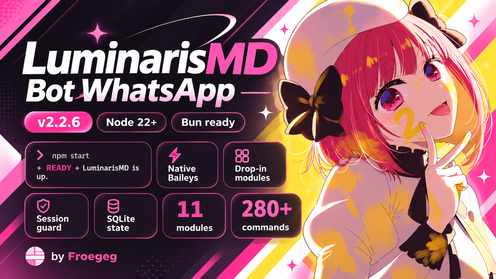

<div align="center">
  
</div>

<h1 align="center">LuminarisMD</h1>

<p align="center">
  <strong>Community Edition — paket rilis siap pakai untuk bot WhatsApp LuminarisMD.</strong><br />
  Pasang, atur, tautkan perangkat, dan jalankan.
</p>

<p align="center">
  
  
  <a href="https://nodejs.org"></a>
  <a href="https://bun.sh"></a>
  
</p>

<p align="center">
  <a href="#sorotan">Sorotan</a> ·
  <a href="#kebutuhan">Kebutuhan</a> ·
  <a href="#instalasi-cepat">Instalasi cepat</a> ·
  <a href="#instalasi-manual">Instalasi manual</a> ·
  <a href="#konfigurasi">Konfigurasi</a> ·
  <a href="#perintah">Perintah</a> ·
  <a href="#sesi--data">Sesi & data</a> ·
  <a href="#pemecahan-masalah">Pemecahan masalah</a> ·
  <a href="#keamanan">Keamanan</a>
</p>

> **LuminarisMD Community** adalah paket rilis yang siap dijalankan — cukup pasang dependensi, isi konfigurasi, tautkan WhatsApp, lalu bot siap dipakai.

---

## Sorotan

| | Yang kamu dapatkan |
| :--- | :--- |
| **Siap pakai** | Paket rilis yang bisa langsung dijalankan tanpa langkah pengembangan tambahan. |
| **Modul lengkap** | Downloader, konverter, stiker, alat grup, utilitas, dan fitur lain yang tersedia di paket ini. |
| **Menu interaktif** | Kartu menu, navigasi kategori, dan balasan yang rapi langsung di WhatsApp. |
| **Kontrol owner** | Mode, pengaturan, toggle modul, manajemen owner/premium, dan alat administrasi. |
| **Kuota harian** | Batas pemakaian untuk fitur berat dengan reset otomatis. |
| **Penjaga sesi** | Peringatan & alur pemulihan sesi yang aman agar kredensial tidak mudah hilang. |

---

## Kebutuhan

| Kebutuhan | Catatan |
| :--- | :--- |
| **Node.js `>=22.13.0`** | Runtime utama. |
| **npm** | Untuk memasang dependensi. (Bisa juga memakai Bun.) |
| **Git** | Diperlukan saat instalasi karena sebagian dependensi diambil dari repositori Git. |
| **ffmpeg + ffprobe** | Diperlukan untuk fitur audio/video (konversi, unduh format tertentu, speech-to-text). |
| **Akun WhatsApp** | Disarankan nomor khusus. Bot berjalan sebagai perangkat tertaut (*Linked Devices*). |

Install ffmpeg:

```bash
# Debian / Ubuntu
sudo apt install ffmpeg

# Arch / Artix
sudo pacman -S ffmpeg

# macOS
brew install ffmpeg

# Windows (winget)
winget install Gyan.FFmpeg
```

---

## Instalasi cepat

Satu perintah (Linux, macOS, WSL, dan Termux):

```bash
curl -LsSf https://raw.githubusercontent.com/froegeg/LuminarisMD-Community/main/install.sh | sh
```

Installer akan:

1. memeriksa Node.js (`>= 22.13`) dan dependensi dasar,
2. mengunduh paket rilis terbaru (`LuminarisMD.zip`),
3. mengekstrak ke `~/LuminarisMD`,
4. memasang dependensi (`npm install`).

Di Termux, paket sistem (`nodejs-lts`, `unzip`, `libvips`, `python`, `git`, `build-essential`, `pkg-config`) ikut dipasang otomatis, dan paket yang sudah ada di-upgrade agar libc++ tetap cocok dengan Node.js.

Setiap langkah ditampilkan di terminal sekaligus disimpan ke `~/luminaris.install.log` — kirim file itu kalau instalasi gagal.

Opsi:

| Env | Default | Fungsi |
| :--- | :--- | :--- |
| `LUMINARIS_DIR` | `~/LuminarisMD` | Folder tujuan instalasi. |
| `LUMINARIS_LOG` | `~/luminaris.install.log` | Lokasi log instalasi. |
| `LUMINARIS_SKIP_DEPS` | `0` | `1` = lewati instalasi paket sistem (Termux). |
| `LUMINARIS_SKIP_INSTALL` | `0` | `1` = lewati `npm install`. |

Contoh memasang ke folder lain:

```bash
curl -LsSf https://raw.githubusercontent.com/froegeg/LuminarisMD-Community/main/install.sh | LUMINARIS_DIR=/opt/luminaris sh
```

Setelah selesai, lanjut ke [Konfigurasi](#konfigurasi).

---

## Instalasi manual

### 1. Siapkan paket

Salin/ekstrak folder rilis ke lokasi tujuan, lalu masuk ke foldernya:

```bash
cd <folder-rilis>
```

### 2. Pasang dependensi

```bash
npm install
```

Atau dengan Bun:

```bash
bun install
```

### 3. Konfigurasi

Buka `config.js` dan isi pengaturan dasar (minimal nomor bot & owner):

```js
export default {
  botNumber: '628123456789',   // nomor bot, hanya digit (kode negara + nomor)
  ownerNumber: '628987654321', // nomor owner (akses owner / role 0)
  ownerName: 'NamaOwner',
  botName: 'LuminarisMD',

  prefixes: ['!', '.'],
  pairingMode: 'code',         // code | qr | both | ask
  pairingCode: 'LUMINARS',     // opsional, kode pairing 8 karakter
}
```

> Simpan perubahan, lalu jalankan bot. Pengaturan lain (banner, limit harian, mode menu, dll.) juga tersedia di `config.js`.

### 4. Jalankan

```bash
npm start
```

atau:

```bash
node index.js
```

### 5. Tautkan perangkat

| Mode | Alur |
| :--- | :--- |
| `code` | Kode pairing 8 karakter tampil di terminal → masukkan di WhatsApp. |
| `qr` | QR tampil di terminal → pindai dari WhatsApp. |
| `both` | Coba kode pairing dulu, QR sebagai cadangan. |
| `ask` | Terminal menanyakan metode saat pertama kali. |

**Login dengan kode pairing:**

1. Jalankan bot dan tunggu kode muncul di terminal.
2. Buka **WhatsApp → Settings → Linked devices → Link a device → Link with phone number**.
3. Masukkan kode yang ditampilkan bot.
4. Disconnect/restart singkat setelah pairing berhasil itu **normal** — bot akan tersambung kembali otomatis.

---

## Konfigurasi

Pengaturan utama ada di `config.js`. Beberapa hal penting:

| Bagian | Contoh | Keterangan |
| :--- | :--- | :--- |
| Identitas | `botName`, `botNumber`, `ownerNumber`, `ownerName` | Nomor & nama bot/owner. |
| Prefix | `prefixes: ['!', '.']` | Awalan perintah yang dikenali. |
| Pairing | `pairingMode`, `pairingCode` | Metode penautan perangkat. |
| Tampilan | `bannerImage`, `bannerUrl`, `menu.*` | Gambar & gaya menu. |
| Limit | `dailyLimit` | Kuota harian untuk fitur berat (`max: 0` untuk menonaktifkan). |
| Log | `logLevel` | Tingkat detail log (`silent` / `default` / `debug` / `verbose`). |

> Perubahan pada `config.js` biasanya diikuti restart otomatis saat bot berjalan.

---

## Perintah

Prefix bawaan: `!` dan `.` (contoh di bawah memakai `!`).

```text
!menu                 Menu utama & kategori
!menu <kategori>      Buka halaman kategori
!menu kategori        Indeks kategori
!allmenu              Daftar perintah lengkap (teks)
```

| Perintah | Fungsi |
| :--- | :--- |
| `!menu` / `!help` | Menu interaktif dan navigasi fitur. |
| `!ping` | Cek status dan latency. |
| `!limit` | Lihat sisa kuota harian. |
| `!botinfo` | Info bot & statistik. |
| `!owner` | Kartu kontak owner. |

> Daftar perintah lengkap mengikuti fitur yang aktif di paketmu — lihat langsung lewat `!menu` / `!allmenu` di bot.

**Akses owner:** nomor di `ownerNumber` menjadi owner (role 0). Owner dapat mengelola mode, pengaturan, modul, dan akses pengguna melalui perintah owner yang tersedia di menu.

---

## Sesi & data

| Lokasi | Isi |
| :--- | :--- |
| `config.js` | Pengaturan bot. |
| `session/` | Kredensial perangkat tertaut WhatsApp. **Sangat sensitif.** |
| `data/` | Data runtime (database, pengaturan dinamis, kuota, dsb.). |
| `logs/` | Log runtime untuk pemecahan masalah. |

### Catatan penting sesi

> [!WARNING]
> `!session reset` memindahkan file sesi lokal ke karantina dan **menghentikan koneksi bot**. Setelah reset, bot **tidak bisa mengirim/menerima pesan sampai pairing ulang** dilakukan dari HP. Entri perangkat lama di WhatsApp mungkin masih perlu dihapus manual di **Linked devices**.

| Perintah | Kegunaan |
| :--- | :--- |
| `!session status` | Cek kondisi sesi. |
| `!session keep` | Pertahankan sesi & biarkan bot reconnect (pilihan aman saat gangguan jaringan). |
| `!session reset confirm` | Karantina sesi & mulai pairing ulang (hanya jika kamu siap pairing ulang). |
| `!session restore` | Coba pulihkan dari karantina (hanya jika sesi remote masih valid). |

> Jangan reset sesi sebagai langkah perbaikan rutin. Jika koneksi hanya tidak stabil, gunakan `!session keep`.

---

## Pemecahan masalah

| Gejala | Yang perlu dilakukan |
| :--- | :--- |
| **Bot tidak merespons** | Cek prefix, mode (`public`/`self`), mode maintenance, dan koneksi. Lihat `logs/`. |
| **Pairing/kode tidak muncul** | Pastikan `botNumber` hanya digit & `pairingMode` benar. Coba `qr` atau `ask`. |
| **`401 logged out` / sesi ditolak** | Cek `!session status`. Jika perlu, `!session reset` lalu pairing ulang dari HP. |
| **`440 connection replaced`** | Sesi dipakai proses/mesin lain. Hentikan proses lain; jangan jalankan satu sesi di dua tempat. |
| **Restart singkat setelah pairing** | Normal, bot akan reconnect otomatis. |
| **Fitur media/audio/video gagal** | Pastikan `ffmpeg` & `ffprobe` terpasang dan bisa dipanggil dari terminal. |
| **Gagal `npm install` (sharp/canvas)** | Gunakan Node.js yang sesuai, siapkan build tools sistem, hapus `node_modules`, lalu install ulang. |
| **Perintah/fitur tidak ada** | Fitur bisa nonaktif. Cek menu dan (untuk owner) pengaturan/toggle modul. |

---

## Keamanan

- **Perlakukan `session/` seperti password.** Siapa pun yang memegangnya dapat mengendalikan akun tertaut.
- **Gunakan nomor khusus** untuk bot. Ini klien WhatsApp tidak resmi; pembatasan akun mungkin terjadi.
- **Jangan bagikan** `session/`, `data/`, log, atau `config.js` yang berisi data pribadi.
- **Jaga akses owner.** Owner memiliki kendali penuh atas bot.

> LuminarisMD tidak berafiliasi dengan WhatsApp atau Meta. WhatsApp adalah merek dagang Meta Platforms, Inc.
